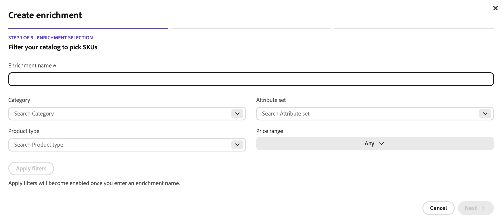
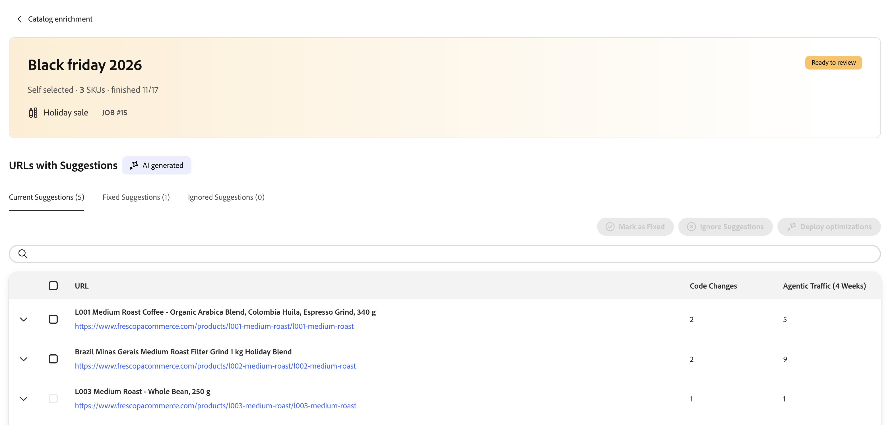

# 目錄擴充

目錄擴充是原生[!DNL Adobe Commerce]功能，可協助您改善產品名稱和詳細說明，以便當購物者使用LLM和AI助理進行產品研究和探索時，能更準確地呈現您的目錄。

## 運作方式 {#how-it-works}

您的[!DNL Adobe Commerce]產品目錄是產品資料的記錄系統：名稱、說明、屬性、定價及詳細目錄。 [!DNL Adobe Commerce]將即時目錄資料連線至Adobe AI體驗。 從那裡，目錄代理程式可以識別產品名稱和完整說明中的間隙、提出改進建議，並將已核准的變更寫回Commerce，以便您可以在Commerce管理員中檢閱。

透過目錄擴充，您可以：

- 找出產品名稱及詳細說明中的差距和不一致，以影響LLM解譯產品的方式。
- 檢閱支援內容的建議改進，包括理由和前後比較。
- 將核准的更新直接套用至Commerce目錄，使管理員、店面和讀取這些欄位的其他管道保持一致。

由於產品名稱和完整說明會在Commerce中上線，因此改善一次複製可讓使用該產品資料的每個管道受益。 其優點取決於系統重新整理的方式和時間。

| 方向 | 用途 |
| --- | --- |
| Commerce目錄 — >分析 | 目錄和代理流量訊號可揭示擴充建議機會。 |
| 擴充 — > Commerce目錄 | 在您核准更新後，產品名稱和說明的變更會儲存至Commerce目錄，讓管理員和店面可反映最佳化的值。 |

### 存取目錄擴充

開始之前，請先檢閱部署特定的[AI產品探索先決條件](prerequisites.md)。 在您完成Commerce平台的設定後，請前往「管理員」中的&#x200B;**[!UICONTROL AI Product Discovery]** > **[!UICONTROL Catalog Enrichment]**。

{zoomable="yes"}

目錄擴充工作區包含&#x200B;**[!UICONTROL Optimizations]**、**[!UICONTROL Brand governance]**&#x200B;和&#x200B;**[!UICONTROL Settings]**&#x200B;標籤。

- 使用&#x200B;**[!UICONTROL Optimizations]**&#x200B;標籤檢閱以代理流量為基礎的探索訊號並管理擴充工作。
- 使用&#x200B;**[!UICONTROL Brand Governance]**&#x200B;索引標籤以[定義[!DNL Commerce Catalog Agent]產生的產品名稱和說明的需求](brand-governance.md)。
- 使用&#x200B;**[!UICONTROL Settings]**&#x200B;索引標籤來[將您的Commerce執行個體](settings.md)連線到AI產品探索。

共用擴充功能也能啟用PDP擴充，其有獨立的工作流程可向AI代理程式公開結構化產品事實。 請參閱[產品詳細資料頁面擴充](pdp-enrichment.md)。

## 目錄擴充的兩個路徑

接收目錄擴充功能的路徑有兩種：

- **代理流量** — 此型別的擴充會在您設定Commerce執行個體後24到48小時自動開始，並在&#x200B;**最佳化**&#x200B;索引標籤上顯示結果。
- **擴充管理員** — 商戶在按一下「**[!UICONTROL Create enrichment]**」按鈕並手動選取要擴充的SKU時，會設定這些擴充。 深入瞭解[擴充管理員](#create-an-enrichment-job)。

### 檢閱並套用目錄擴充 {#review-and-apply}

啟用並設定目錄擴充後，請使用&#x200B;**[!UICONTROL Optimizations]**&#x200B;標籤來檢閱搜尋和代理流量深入分析，並管理擴充工作。

### 檢閱每月代理流量

每個月的代理流量稽核都會識別高流量SKU，並提供建議的批次。 系統會自動針對高代理流量SKU產生最佳化供檢閱。 這些最佳化是根據您的「預設」治理規則自動產生。 每月卡片會顯示產品計數、AI代理程式造訪和工作狀態。 代理流量和自行選取的批次會使用相同的規則選取、確認、執行、稽核和部署工作流程。

### 檢閱需要注意的工作

「**[!UICONTROL Needs your attention]**」區段會醒目顯示需要動作的工作，包括已完成且可供檢閱的工作。 開啟已完成的工作，以在部署前檢閱其建議的產品變更。

### 尋找工作

**[!UICONTROL All jobs]**&#x200B;表格列出每個工作ID、名稱、來源、SKU計數、使用的規則、開始時間和狀態。 來源會識別批次是自行選取或從代理流量推薦。 追蹤處理狀態為&#x200B;**[!UICONTROL Queued]**、**[!UICONTROL Running]**、**[!UICONTROL Completed]**&#x200B;或&#x200B;**[!UICONTROL Failed]**。 在「最佳化」工作區中，這些工作在執行時也可以顯示為&#x200B;**[!UICONTROL Generating]**、產生完成時顯示為&#x200B;**[!UICONTROL Ready to review]**，以及在部署核准的變更後顯示為&#x200B;**[!UICONTROL Deployed]**。 您可以同時執行多個工作。 使用&#x200B;**[!UICONTROL Retry]**&#x200B;重試失敗的工作。

### 建立擴充工作

**若要建立目錄擴充：**

{zoomable="yes"}

1. 在&#x200B;**[!UICONTROL Optimizations]**&#x200B;中，按一下&#x200B;**[!UICONTROL Create enrichment]**。
1. 輸入&#x200B;**擴充名稱**，例如「2026年黑色星期五」。
1. Select **類別**，例如「咖啡」。
1. Select **屬性集**，例如「配件」。
1. Select **產品型別**，例如「簡單產品」。
1. Select **價格範圍**。
1. 按一下&#x200B;**[!UICONTROL Apply filters]**。

   您可以預覽符合擴充條件的產品，然後按一下[自訂]，以進一步限定您要擴充的產品。**&#x200B;**

1. 按一下&#x200B;**[!DNL Next]**&#x200B;並預覽套用至擴充的[治理規則](brand-governance.md)。
1. 按一下&#x200B;**[!DNL Next]**&#x200B;以確認您要擴充的特定產品。
1. 按一下&#x200B;**[!DNL Run enrichment]**。

   擴充工作會執行並顯示在「最佳化」表格上。 當它完成執行時，您可以[檢閱並部署](#review-deploy-catalog)最佳化。

### 檢閱及部署擴充工作 {#review-deploy-catalog}

開啟擴充工作。

{zoomable="yes"}

含有建議的&#x200B;**URL**&#x200B;表格列出所有具有擴充機會的產品。 對於每個產品，您可以：

- **展開列**&#x200B;以檢視AI分析和建議的擴充。
- **在套用之前先編輯**&#x200B;建議的產品名稱或描述，以符合您的品牌語調和銷售准則。
- **針對您要擴充的產品部署最佳化**，並將其直接發佈至您的Adobe Commerce目錄。
- 在稽核並套用擴充後，**標示為固定**。
- **忽略與您目錄策略無關的**&#x200B;建議。

建議分為三個檢視： **目前的建議**、**已修正的建議**&#x200B;和&#x200B;**忽略的建議**。 擴充套用後，它會移至狀態為&#x200B;**已套用**&#x200B;且&#x200B;**在目錄**&#x200B;中檢視動作的固定建議，以驗證Adobe Commerce中的更新。 套用的擴充功能可隨時回覆，以還原原始產品名稱和說明。

## 在管理員中驗證擴充 {#verify-in-admin}

**若要驗證套用的目錄擴充：**

1. 前往Commerce管理員中的&#x200B;**[!UICONTROL Catalog]** > **[!UICONTROL Products]**。
1. 視需要使用篩選器和&#x200B;**[!UICONTROL Store View]**&#x200B;選擇器（例如&#x200B;**[!UICONTROL Default Store View]**）。
1. 搜尋SKU。
1. 在編輯模式中開啟產品。

   產品表單會顯示擴充的產品名稱及/或說明。

   {zoomable="yes"}

1. 可選：如果您要保留手動輸入的名稱，請選取&#x200B;**[!UICONTROL Override Catalog Agent provided Product Name]**。

   手動覆寫會影響建議與目錄保持同步的方式。 如需詳細資訊，請參閱[管理員中的手動覆寫](#manual-override-in-the-admin)。

1. 展開&#x200B;**[!UICONTROL Content]**&#x200B;區段並找出說明欄位。

   當您套用說明變更時，就會顯示擴充說明。

   {zoomable="yes"}

1. 可選：如果您要保留手動輸入的描述，請選取&#x200B;**[!UICONTROL Override Catalog Agent provided Description]**。

手動覆寫會影響建議與目錄保持同步的方式。 如需詳細資訊，請參閱[管理員中的手動覆寫](#manual-override-in-the-admin)。

## 驗證店面的擴充 {#verify-storefront}

**若要驗證店面的擴充：**

1. 在您的店面搜尋SKU。
1. 開啟產品頁面。
1. 確認產品名稱和說明符合您核准的內容。

   擴充功能可能需要一些時間才會出現在您的店面上。

1. 確認顯示完整說明的區域符合您核准的內容。
1. 可選：確認使用相同目錄屬性的下游管道（與您的轉出相關）。

## 覆寫、擷取和過時的建議 {#overrides-ingestion}

在目錄擴充更新產品的名稱或說明後，其他擷取系統可能會變更相同欄位。 範例包括REST API呼叫、CSV匯入和PIM摘要。

### 已重新擷取原始值 {#original-value-reingested}

如果外部程式寫入原始名稱或說明（套用擴充之前存在的值），Commerce會根據目錄擴充規則，繼續遵循該欄位的擴充值。 建議可能不會單獨根據該擷取自動回覆。

### 新值已重新內嵌 {#new-value-reingested}

如果外部程式傳送的新值不是預先擴充文字的重複，Commerce會遵循新目錄值。 例如，將「Red Shoes」重新命名為「Iconic Red Shoes」會取代擴充值。 相關擴充建議通常會標示為&#x200B;*已過時*，因為即時目錄不再符合建議內容。

### 在管理員中手動覆寫 {#manual-override-in-the-admin}

如果您在「[!DNL Adobe Commerce]管理員」中手動編輯產品名稱或說明：

- Admin值會作為該手動變更的記錄系統而獲勝。
- 擴充建議標示為&#x200B;*已過時*。
- 建議工作流程會回到該專案的原始狀態，這樣您就可以重新基準化，或者接受新的建議（如果分析再次執行）。

這些規則可協助您瞭解當多個管道接觸同一個SKU時，目錄擴充、擷取摘要或管理員編輯是否具有權威性。

## 限制和考量事項 {#limits}

- 擴充僅適用於產品名稱和詳細說明。 它不會變更產品詳細資料頁面配置、Widget或其他頁面層級的店面內容。
- 大型目錄和高的URL計數可能會影響分析完成的速度，以及同時出現的建議數量。
- 有意義的建議假設與LLM相關的機器人可以存取您關心的產品URL。 機器人規則、驗證、地理封鎖和重度個人化可能會減少涵蓋範圍。

## 最佳實務 {#best-practices}

- 產品名稱和說明的檔案系統所有權，這樣PIM或摘要工作就不會無意中與目錄擴充衝突。
- 在大量套用標題或說明之前，請先與SEO和品牌團隊協調。
- 主要目錄匯入後重新同步或重新分析，讓建議反映目前的目錄狀態。

## 範例

下列範例說明目錄擴充如何將原始技術屬性轉換為以購物者為中心的敘述性產品副本，供LLM用於回答購物問題。

### 範例：具有技術屬性的咖啡產品

咖啡retailer的目錄只儲存中燒咖啡豆產品的技術規格：豆類、產地、加工方法、燒烤等級及高度範圍。 這些欄位會描述產品，但不會將其價值傳達給購物者，因此AI助理在回答「什麼咖啡有流暢、低酸的味道？」這類問題時幾乎無法工作。

目錄擴充會透過技術屬性和原因的互動方式來推斷購物者相關特性：

| 技術屬性 | 推斷的特性 | 推理 |
| --- | --- | --- |
| 蜂蜜加工業，Medium烤肉 | 低酸度 | 蜂蜜加工期間留在豆子上的水果粘液會抑制酸度，而中燒烤會分解殘留的酸性化合物。 |
| 蜂蜜加工業，阿拉比卡，Medium烤肉 | 榛子味 | 來自粘膠的水果糖與阿拉伯的天然堅果音相結合，在中等烘烤時放大。 |
| 蜂蜜加工業，阿拉比卡 | 豐富奶油口感 | 乾燥期間從粘液吸收的油會增加粘度和身體。 |
| 蜂蜜加工工藝，海拔900-1200米 | 焦糖底色 | 高海拔的豆子密度更高，糖分更複雜，而且經過蜂蜜加工而加深。 |

目錄擴充會將這些推斷的特徵套用至產品復本：

- **Before**： 「Medium烤咖啡豆 — 阿拉比卡、巴西米納斯吉拉斯、蜂蜜加工、900-1200米」
- **之後**： 「巴西Minas Gerais種植於900-1200米之間的阿拉比卡豆類，經過蜂蜜加工及中等烘烤，呈現天然甜潤的口感，具有獨特的榛子字型、焦糖底色和低酸度。 始終如一、平易近人的特製咖啡，傾倒咖啡體驗最佳。」

更新的名稱和說明會直接儲存到Commerce目錄中，因此店面、LLM摘要和讀取這些欄位的其他管道都會反映相同的擴充副本。

### 範例：模組化傢俱組態

傢俱retailer銷售模組化組合沙發，其中產品說明僅列出組態程式碼和網狀架構名稱，例如`6 Standard Seats + 6 Standard Sides in Sapphire Navy Corded Velvet`。 對於回頭的客戶來說，這種速記是可以理解的，但提供給AI助理一些產品如何運作或是什麼使其耐用或舒適的上下文。

目錄擴充功能將組態和網狀架構屬性擴充為敘述性說明，說明每個元件的功用以及對購物者而言重要的原因：

- **Before**：「6個標準座椅+ 6個藍寶石海軍線天鵝絨標準側面」
- **After**：「此組態包含6組標準座位插入組與6組標準側邊插入組，可互換作為臂或背使用，構成您配置的模組建置組塊。 每張座椅均採用標準泡沫塑膠，並搭配三層高密度塑膠層，既可保持提升度，又可避免下垂。 藍寶石海軍藍絲絨護套既耐用，又豪華，其質感的護絲可為您帶來細膩的光澤和柔軟的毛絨感。 封面是手工縫製的，外觀精準、量身打造，而且可更換機器，因此您的部分可以隨您的空間而改變。」

由於豐富型說明會回寫至Commerce目錄，因此AI機器人可用於抓取產品詳細資料頁面以及任何使用產品目錄資料的下游管道或摘要，而不會變更購物者在該頁面上看到的版面配置或設計。
