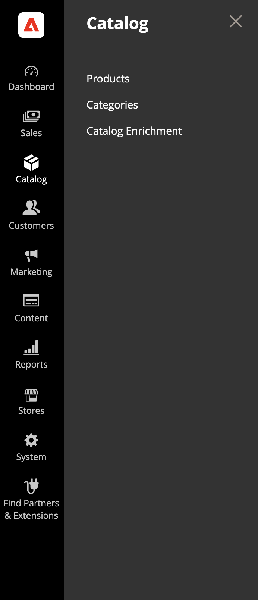
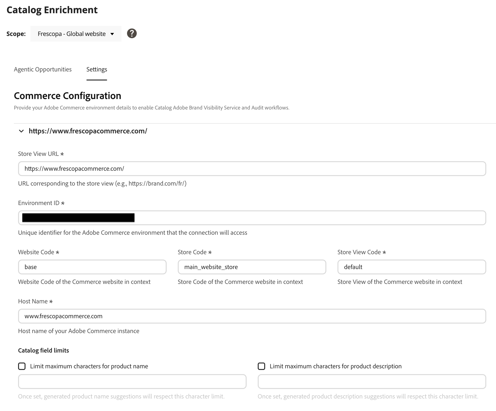
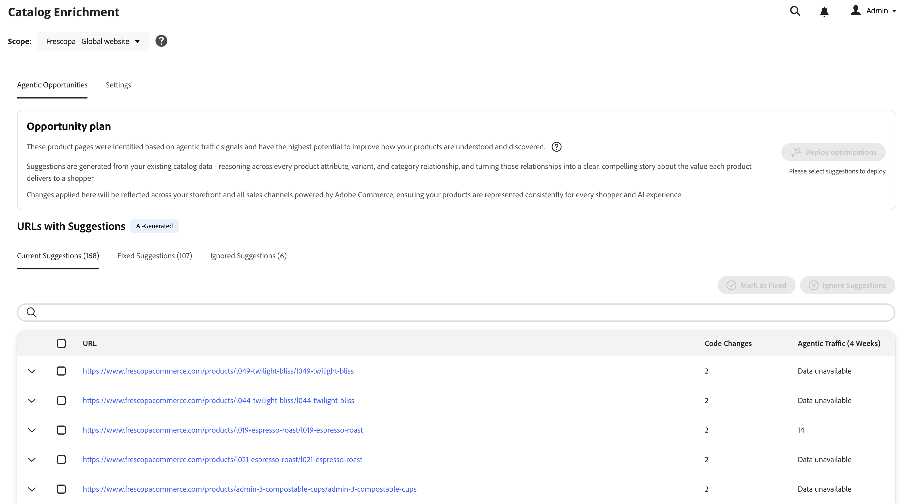
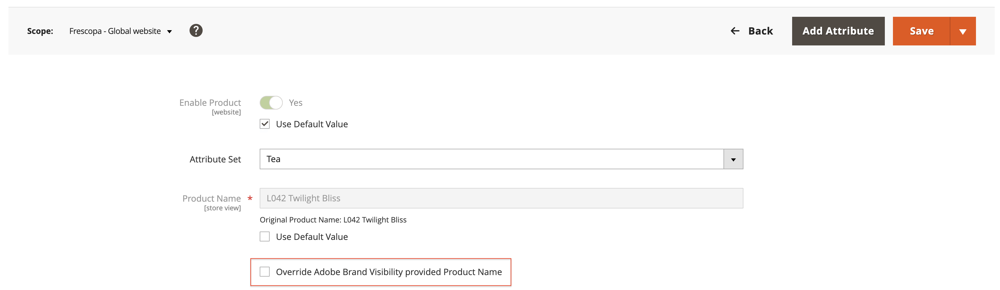
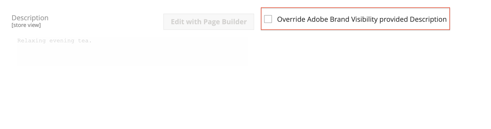

# 目錄擴充

目錄擴充是原生[!DNL Adobe Commerce]功能，可協助您改善產品名稱和詳細說明，以便當購物者使用LLM和AI助理進行產品研究和探索時，能更準確地呈現您的目錄。

>[!NOTE]
>
>目錄擴充功能由[!DNL Commerce Catalog Agent]和[!DNL Adobe Brand Visibility]幕後提供技術支援。 您使用擴充作為Commerce目錄工作流程的一部分。 您沒有另外管理Adobe Brand Visibility整合，以套用核准的名稱和說明更新。 如需Commerce外部更廣泛的LLM監視和最佳化，請參閱[[!DNL Adobe Brand Visibility] 產品檔案](https://experienceleague.adobe.com/zh-hant/docs/brand-visibility/using/home)。

## 運作方式 {#how-it-works}

您的[!DNL Adobe Commerce]產品目錄是產品資料的記錄系統：名稱、說明、屬性、定價及詳細目錄。[!DNL Adobe Commerce] Storefront MCP （模型內容通訊協定）將即時目錄資料連線到Adobe AI體驗。 從那裡，目錄代理程式可以識別產品名稱和完整說明中的間隙、提出改進建議，並將已核准的變更寫回Commerce，以便您可以在Commerce管理員中檢閱。

透過目錄擴充，您可以：

- 找出產品名稱及詳細說明中的差距和不一致，以影響LLM解譯產品的方式。
- 檢閱支援內容的建議改進，包括理由和前後比較。
- 將核准的更新直接套用至Commerce目錄，使管理員、店面和讀取這些欄位的其他管道保持一致。

由於產品名稱和完整說明會在Commerce中上線，因此改善一次複製可讓使用該產品資料的每個管道受益。 其優點取決於系統重新整理的方式和時間。

| 方向 | 用途 |
| --- | --- |
| Commerce目錄 — >分析 | 目錄和URL訊號會提供擴充建議。 |
| 擴充 — > Commerce目錄 | 在您核准更新後，產品名稱和說明的變更會儲存至Commerce目錄，讓管理員和店面可反映最佳化的值。 |

## 這是給誰的 {#who-this-is-for}

- 想要讓LLM導向的答案中的產品資料正確且一致的數位行銷人員和銷售商。
- 需要控制方式大規模改善目錄複製的數位行銷人員和銷售商。
- 擁有目錄完整性、管理流程以及提供產品屬性的整合(API、CSV、PIM)的Commerce管理員。

## 先決條件 {#prerequisites}

當您擁有目錄擴充的存取權時，下列先決條件即適用。

- 您的店面可由LLM導向和代理程式機器人抓取，其中目錄感知建議需要抓取涵蓋範圍。
- 必要的Commerce服務和目錄連線已啟用且狀況良好。 請參閱[啟用目錄擴充](#enable-catalog-enrichment)以瞭解更多資訊。
- 存取目錄擴充功能的Commerce管理員使用者已透過Adobe IMS登入。 檢視[IMS登入與組織需求](#ims-sign-in-requirements)。
- 您有[Adobe Admin Console](https://helpx.adobe.com/tw/business/enterprise/plan-your-deployment/basic-concepts/admin-console.html)的存取權。
- 貴組織已針對基礎AI服務簽署GenAI附加條款，或明確選擇退出。

>[!NOTE]
>
>在設定過程中，Commerce會檢查貴組織是否已簽署涵蓋目錄擴充背後之AI服務的GenAI附加條款。 如果您尚未簽署騎士或選擇退出，系統會提示您簽署或更新騎士，然後才能使用目錄擴充。

### IMS登入和組織需求 {#ims-sign-in-requirements}

目錄擴充使用登入的Commerce管理員使用者的Adobe IMS存取權杖來連線至[!DNL Adobe Brand Visibility]。 僅使用Commerce使用者名稱和密碼的原生Commerce管理員登入不會產生此Token，因此存取目錄擴充的管理員使用者必須透過Adobe IMS登入。

若要支援IMS登入，您的Commerce執行個體必須啟用Commerce管理與Adobe ID的整合。 請參閱[使用Adobe ID設定Commerce管理整合](/help/getting-started/adobe-ims-config.md)。

>[!IMPORTANT]
>
>啟用Commerce管理與Adobe ID的整合是一項執行個體範圍的變更。 啟用後，每位管理員使用者都必須透過Adobe IMS進行驗證，原生Commerce使用者名稱和密碼登入將不再可用。 啟用這項整合之前，請先檢閱[Adobe Identity Management Service (IMS)整合總覽](/help/getting-started/adobe-ims-integration-overview.md)。

與您的Commerce執行個體相關聯的Adobe IMS組織，通常與持有您[!DNL Adobe Brand Visibility]權益的IMS組織不同。 啟用Commerce與Adobe ID管理整合本身並不會授與品牌可見度軟體權利檔案的存取權，而且不需要兩個組織相同。 與您的Adobe管理員或帳戶團隊合作，確認在您的設定中需要哪些IMS組織成員資格和帳戶存取目錄擴充。

## 啟用目錄擴充 {#enable-catalog-enrichment}

在檢閱或套用建議之前，請與您的Commerce管理員或實作合作夥伴合作，確認下列事項：

### 安裝目錄擴充和目錄服務擴充功能

1. 在您的Commerce執行個體中安裝目錄擴充擴充功能，並套用變更：

   ```bash
   composer require magento/module-catalog-enrichment:^2.1
   bin/magento setup:upgrade
   bin/magento cache:flush
   ```

   `setup:upgrade`啟用擴充功能、建立其資料庫表格並授與管理員許可權。 之後清除快取，讓許可權生效。 在生產模式中，也執行`bin/magento setup:di:compile`和`bin/magento setup:static-content:deploy`。

1. 如果您尚未安裝目錄服務，請[安裝](https://experienceleague.adobe.com/zh-hant/docs/commerce/catalog-service/installation#install-the-catalog-service-extension)。

   **[!UICONTROL Catalog enrichment]**&#x200B;現在可在您的Commerce執行個體中使用。

>[!IMPORTANT]
>
>目錄擴充2.1.2和更新版本需要PHP 8.3或更新版本上的Adobe Commerce 2.4.7或更新版本，並且無法與[!DNL Adobe Brand Visibility]擴充功能(`magento/llm-optimizer`)一起安裝。 如果您已安裝它，請在升級前將它移除。 請參閱發行說明中的[從舊版升級](#upgrade-from-earlier-versions)。

### 存取目錄擴充

安裝目錄擴充和目錄服務擴充功能後，「管理員」中的&#x200B;**[!UICONTROL AI Product Discovery]** > **[!UICONTROL Catalog Enrichment]**&#x200B;下會提供目錄擴充功能。

{zoomable="yes"}

>[!NOTE]
>
>**[!UICONTROL AI Product Discovery]**&#x200B;功能表也列出&#x200B;**[!UICONTROL Product Details Page Enrichment (Beta)]**。 產品詳細資料頁面擴充功能處於測試版，尚未正式發佈。

### 設定目錄擴充 {#configure-catalog-enrichment}

在「**[!UICONTROL Settings]**」索引標籤上設定目錄擴充，讓[!DNL Commerce Catalog Agent]可以連線至您的[!DNL Adobe Commerce]環境，並在Commerce管理員中顯示建議。

此標籤上的欄位會識別目錄擴充所連線的Commerce環境和存放區檢視。 它們與持有您[!DNL Adobe Brand Visibility]權益的Adobe IMS組織不同。 檢視[IMS登入與組織需求](#ims-sign-in-requirements)。

1. 在Admin中，移至&#x200B;**[!UICONTROL AI Product Discovery]** > **[!UICONTROL Catalog Enrichment]**。
1. 在頁面頂端的&#x200B;**[!UICONTROL Scope]**&#x200B;清單中，選取您要設定的商店檢視，或保留&#x200B;**[!UICONTROL All Store Views]**&#x200B;以跨商店檢視管理設定。
1. 開啟&#x200B;**[!UICONTROL Settings]**&#x200B;標籤。
1. 在&#x200B;**[!UICONTROL Commerce Configuration]**&#x200B;中，展開標示其URL的存放區檢視面板。

   提供您的[!DNL Adobe Commerce]環境詳細資訊，以啟用目錄Adobe Brand Visibility服務和稽核工作流程。

   目錄擴充設定索引標籤上的{zoomable="yes"}

1. 輸入存放區檢視所需的連線詳細資料。

   - **[!UICONTROL Store View URL]**：對應至商店檢視的URL （例如，`https://brand.example.com/fr/`）。
   - **[!UICONTROL Environment ID]**：連線存取之[!DNL Adobe Commerce]環境的唯一識別碼。
   - **[!UICONTROL Website Code]**、**[!UICONTROL Store Code]**&#x200B;和&#x200B;**[!UICONTROL Store View Code]**： Commerce網站的網站、商店和商店檢視代碼。 這些值必須符合您Commerce管理員中的程式碼。
   - **[!UICONTROL Host Name]**： [!DNL Adobe Commerce]執行個體的主機名稱。

1. 按一下&#x200B;**[!UICONTROL Save]**。

儲存後，請等待任何初始同步或驗證工作完成，然後再為該存放區檢視依賴目錄或稽核結果。 產品建議最多可能需要24小時的時間才會出現在&#x200B;**[!UICONTROL Catalog Enrichment]**&#x200B;頁面上。

若要移除存放區檢視設定，請展開該專案，然後按一下&#x200B;**[!UICONTROL Delete]**。

#### 欄位說明 {#commerce-connection-fields}

在&#x200B;**[!UICONTROL Commerce Configuration]**&#x200B;表單上，必填欄位標有星號(*)。

| 欄位 | 必填 | 說明 |
| --- | --- | --- |
| 存放區檢視URL | 是 | 對應至商店檢視的URL （例如，`https://brand.example.com/fr/`）。 |
| 環境ID | 是 | 連線存取之[!DNL Adobe Commerce]環境的唯一識別碼。 |
| 網站程式碼 | 是 | Commerce網站的網站程式碼。 |
| 存放區代碼 | 是 | Commerce網站的商店代碼。 |
| 存放區檢視代碼 | 是 | Commerce網站的商店檢視。 |
| 主機名稱 | 是 | 您的[!DNL Adobe Commerce]執行個體的主機名稱。 |

### 檢閱並套用目錄擴充 {#review-and-apply}

啟用及設定目錄擴充後，**[!UICONTROL Agentic Opportunities]**&#x200B;標籤上會顯示產品建議。 您可以從這裡檢閱建議，並將核准的更新套用至Commerce目錄中的產品名稱和詳細說明。

目錄擴充使用下列工作流程檢視：

- **[!UICONTROL Current Suggestions]**：要檢閱的新專案或作用中專案。
- **[!UICONTROL Fixed Suggestions]**：您已經套用或解析的專案。
- **[!UICONTROL Ignored Suggestions]**：您刻意從動作中排除的專案。

{zoomable="yes"}

### 部署已核准的建議 {#review-deploy-catalog}

若要部署已核准的建議，請執行下列動作：

1. 選取&#x200B;**[!UICONTROL Current Suggestions]**。
1. 按一下URL或SKU列的展開控制項，以顯示建議的產品名稱和產品說明更新。
1. 檢閱建議，並確認其符合您的銷售和SEO策略。

您可以在部署建議之前對其進行編輯，如果建議不符合您的策略，則將其移至&#x200B;**[!UICONTROL Ignored Suggestions]**。

1. 選取URL或SKU要更新的列。
1. 按一下&#x200B;**[!UICONTROL Deploy optimizations]**&#x200B;並確認。

核准的名稱和描述變更會像其他產品更新一樣儲存到您的[!DNL Adobe Commerce]目錄。

>[!IMPORTANT]
>
>將每個套用的更新視為生產目錄變更。 使用您一般的變更控制、測試和QA實務。 只有在銷售和SEO利害關係人在最終副本上達成一致後，才套用更新。

套用更新後，建議會移至狀態為&#x200B;**標籤為「已修正」**&#x200B;的&#x200B;**[!UICONTROL Fixed Suggestions]**。

## 在管理員中驗證擴充 {#verify-in-admin}

**若要驗證套用的目錄擴充：**

1. 前往Commerce管理員中的&#x200B;**[!UICONTROL Catalog]** > **[!UICONTROL Products]**。
1. 視需要使用篩選器和&#x200B;**[!UICONTROL Store View]**&#x200B;選擇器（例如&#x200B;**[!UICONTROL Default Store View]**）。
1. 搜尋SKU。
1. 在編輯模式中開啟產品。

   產品表單會顯示擴充的產品名稱及/或說明。

   {zoomable="yes"}

1. 可選：如果您要保留手動輸入的名稱，請選取&#x200B;**[!UICONTROL Override Catalog Agent provided Product Name]**。

   手動覆寫會影響建議與目錄保持同步的方式。 如需詳細資訊，請參閱[管理員中的手動覆寫](#manual-override-in-the-admin)。

1. 展開&#x200B;**[!UICONTROL Content]**&#x200B;區段並找出說明欄位。

   當您套用說明變更時，就會顯示擴充說明。

   {zoomable="yes"}

1. 可選：如果您要保留手動輸入的描述，請選取&#x200B;**[!UICONTROL Override Catalog Agent provided Description]**。

手動覆寫會影響建議與目錄保持同步的方式。 如需詳細資訊，請參閱[管理員中的手動覆寫](#manual-override-in-the-admin)。

## 驗證店面的擴充 {#verify-storefront}

**若要驗證店面的擴充：**

1. 在您的店面搜尋SKU。
1. 開啟產品頁面。
1. 確認產品名稱和說明符合您核准的內容。

   擴充功能可能需要一些時間才會出現在您的店面上。

1. 確認顯示完整說明的區域符合您核准的內容。
1. 可選：確認使用相同目錄屬性的下游管道（與您的轉出相關）。

## 覆寫、擷取和過時的建議 {#overrides-ingestion}

在目錄擴充更新產品的名稱或說明後，其他擷取系統可能會變更相同欄位。 範例包括REST API呼叫、CSV匯入和PIM摘要。

### 已重新擷取原始值 {#original-value-reingested}

如果外部程式寫入原始名稱或說明（套用擴充之前存在的值），Commerce會根據目錄擴充規則，繼續遵循該欄位的擴充值。 建議可能不會單獨根據該擷取自動回覆。

### 新值已重新內嵌 {#new-value-reingested}

如果外部程式傳送的新值不是預先擴充文字的重複，Commerce會遵循新目錄值。 例如，將「Red Shoes」重新命名為「Iconic Red Shoes」會取代擴充值。 相關擴充建議通常會標示為&#x200B;*已過時*，因為即時目錄不再符合建議內容。

### 在管理員中手動覆寫 {#manual-override-in-the-admin}

如果您在「[!DNL Adobe Commerce]管理員」中手動編輯產品名稱或說明：

- Admin值會作為該手動變更的記錄系統而獲勝。
- 擴充建議標示為&#x200B;*已過時*。
- 建議工作流程會回到該專案的原始狀態，這樣您就可以重新基準化，或者接受新的建議（如果分析再次執行）。

這些規則可協助您瞭解當多個管道接觸同一個SKU時，目錄擴充、擷取摘要或管理員編輯是否具有權威性。

## 限制和考量事項 {#limits}

- 擴充目前僅支援英文產品內容。
- 擴充僅適用於產品名稱和詳細說明。 它不會變更PDP配置、Widget或其他頁面層級的店面內容。
- 大型目錄和高的URL計數可能會影響分析完成的速度，以及同時出現的建議數量。
- 有意義的建議假設與LLM相關的機器人可以存取您關心的產品URL。 機器人規則、驗證、地理封鎖和重度個人化可能會減少涵蓋範圍。

## 最佳實務 {#best-practices}

- 產品名稱和說明的檔案系統所有權，這樣PIM或摘要工作就不會無意中與目錄擴充衝突。
- 在大量套用標題或說明之前，請先與SEO和品牌團隊協調。
- 主要目錄匯入後重新同步或重新分析，讓建議反映目前的目錄狀態。

## 範例

下列範例說明目錄擴充如何將原始技術屬性轉換為以購物者為中心的敘述性產品副本，供LLM用於回答購物問題。

### 範例：具有技術屬性的咖啡產品

咖啡retailer的目錄只儲存中燒咖啡豆產品的技術規格：豆類、產地、加工方法、燒烤等級及高度範圍。 這些欄位會描述產品，但不會將其價值傳達給購物者，因此AI助理在回答「什麼咖啡有流暢、低酸的味道？」這類問題時幾乎無法工作。

目錄擴充會透過技術屬性和原因的互動方式來推斷購物者相關特性：

| 技術屬性 | 推斷的特性 | 推理 |
| --- | --- | --- |
| 蜂蜜加工業，Medium烤肉 | 低酸度 | 蜂蜜加工期間留在豆子上的水果粘液會抑制酸度，而中燒烤會分解殘留的酸性化合物。 |
| 蜂蜜加工業，阿拉比卡，Medium烤肉 | 榛子味 | 來自粘膠的水果糖與阿拉伯的天然堅果音相結合，在中等烘烤時放大。 |
| 蜂蜜加工業，阿拉比卡 | 豐富奶油口感 | 乾燥期間從粘液吸收的油會增加粘度和身體。 |
| 蜂蜜加工工藝，海拔900-1200米 | 焦糖底色 | 高海拔的豆子密度更高，糖分更複雜，而且經過蜂蜜加工而加深。 |

目錄擴充會將這些推斷的特徵套用至產品復本：

- **Before**： 「Medium烤咖啡豆 — 阿拉比卡、巴西米納斯吉拉斯、蜂蜜加工、900-1200米」
- **之後**： 「巴西Minas Gerais種植於900-1200米之間的阿拉比卡豆類，經過蜂蜜加工及中等烘烤，呈現天然甜潤的口感，具有獨特的榛子字型、焦糖底色和低酸度。 始終如一、平易近人的特製咖啡，傾倒咖啡體驗最佳。」

更新的名稱和說明會直接儲存到Commerce目錄中，因此店面、LLM摘要和讀取這些欄位的其他管道都會反映相同的擴充副本。

### 範例：模組化傢俱組態

傢俱retailer銷售模組化組合沙發，其中產品說明僅列出組態程式碼和網狀架構名稱，例如`6 Standard Seats + 6 Standard Sides in Sapphire Navy Corded Velvet`。 對於回頭的客戶來說，這種速記是可以理解的，但提供給AI助理一些產品如何運作或是什麼使其耐用或舒適的上下文。

目錄擴充功能將組態和網狀架構屬性擴充為敘述性說明，說明每個元件的功用以及對購物者而言重要的原因：

- **Before**：「6個標準座椅+ 6個藍寶石海軍線天鵝絨標準側面」
- **After**：「此組態包含6組標準座位插入組與6組標準側邊插入組，可互換作為臂或背使用，構成您配置的模組建置組塊。 每張座椅均採用標準泡沫塑膠，並搭配三層高密度塑膠層，既可保持提升度，又可避免下垂。 藍寶石海軍藍絲絨護套既耐用，又豪華，其質感的護絲可為您帶來細膩的光澤和柔軟的毛絨感。 封面是手工縫製的，外觀精準、量身打造，而且可更換機器，因此您的部分可以隨您的空間而改變。」

由於豐富型說明會回寫至Commerce目錄，因此AI機器人可用於抓取產品詳細資料頁面以及任何使用產品目錄資料的下游管道或摘要，而不會變更購物者在該頁面上看到的版面配置或設計。

## 發行說明 {#release-notes}

這些發行說明會擷取目錄擴充擴充擴充功能(`magento/module-catalog-enrichment`)中的新增和修正：

新功能
修正和改良
已知問題

### v2.1.2

*2026年10月22日*

[!BADGE 支援]{type=Informative tooltip="支援"} PHP 8.3到8.5上的Adobe Commerce 2.4.9、2.4.8、2.4.7。

2.1.2版將目錄擴充設為獨立擴充功能。 它現在包含先前由個別[!DNL Adobe Brand Visibility]擴充功能(`magento/llm-optimizer`)提供的所有內容：將已核准的建議套用至目錄、復原建議，以及保護您自己的編輯不會被覆寫。

#### 從舊版升級 {#upgrade-from-earlier-versions}

>[!IMPORTANT]
>
>版本2.1.2無法與[!DNL Adobe Brand Visibility]擴充功能一起安裝。 如果已安裝，請在升級時將其移除。

1. 移除[!DNL Adobe Brand Visibility]擴充功能（如果已安裝）：

   ```bash
   composer remove magento/llm-optimizer
   ```

   如果擴充功能是以複製或連結`Magento/LlmoCatalog`到`app/code`的方式安裝，請刪除該目錄。 不僅要停用模組：停用的模組若仍在磁碟中，可能會導致`setup:upgrade`卸除儲存擴充產品原始值的表格。

1. 更新目錄擴充並套用變更：

   ```bash
   composer require magento/module-catalog-enrichment:^2.1
   bin/magento setup:upgrade
   bin/magento cache:flush
   ```

   升級後排清快取。 升級會將現有的存取許可權移到新許可權資源，而且這些許可權要等到快取清除後才會生效。

#### 需求

 **PHP 8.3和Adobe Commerce 2.4.7或更高版本**—PHP 8.1生命週期結束，PHP 8.2於2026年12月31日到達生命週期結束，因此兩者都不受支援。 不支援Adobe Commerce 2.4.6和較舊版本。

#### 新功能

 **[!UICONTROL AI Product Discovery]功能表** — 目錄擴充頁面在管理員側邊欄中現在有自己的區段。 前往&#x200B;**[!UICONTROL AI Product Discovery]** > **[!UICONTROL Catalog Enrichment]**。 之前，頁面位於&#x200B;**[!UICONTROL Catalog]**&#x200B;下方。

 [!BADGE Beta]{type=Informative tooltip="尚未正式提供"} **[!UICONTROL Product Details Page Enrichment (Beta)]** — 在&#x200B;**[!UICONTROL AI Product Discovery]**&#x200B;下有一個新頁面，可檢閱產品詳細資料頁面的擴充建議。 產品詳細資料頁面擴充功能處於測試版，尚未正式發佈。

 **套用並復原核准的建議** — 此擴充功能會將核准的名稱和描述更新寫入目錄。 Commerce會記錄每個擴充屬性在首次變更時的原始值，因此復原一律會還原擴充前的值，即使相同屬性套用數個建議後亦然。

 **已接受您的編輯** — 當您在「管理員產品」表單中變更擴充名稱或說明時、**[!UICONTROL Update Attributes]**&#x200B;或透過匯入，您的值會保留，相關建議會標籤為&#x200B;*已過時*。 在預設範圍中所做的變更只會影響繼承值的存放區檢視。

 **建議的唯讀目錄存取權**—[!DNL Commerce Catalog Agent]可以讀取產品、類別、屬性集和產品型別資料，以選取要分析的產品。 讀取只會傳回標籤為&#x200B;**[!UICONTROL Used in Product Listing]**&#x200B;的屬性，加上可擴充的屬性。 它無法變更目錄資料。

#### 修正和改良

 **重試套用報告成功** — 如果套用要求在完成之後重試，重試現在會將變更報告為已套用，而不是報告無變更。 沒有內容會寫兩次。

 **只有已核准的服務才能變更目錄** — 套用和復原僅接受來自[!DNL Commerce Catalog Agent]的請求。 之前，使用者接受任何有效的Adobe IMS權杖。 同樣的檢查現在也適用於SOAP要求。

 **更清楚的錯誤**—Adobe IMS中斷現在會傳回`401`而非`500`，因此不會針對目錄重試請求，而且會拒絕無法辨識的Adobe IMS環境，而非將其視為中繼環境。

 **Adobe IMS環境** — 目錄擴充現在預設會登入生產Adobe IMS環境，包括連線到非生產[!DNL Commerce Services]資料空間的執行個體。 以前，這些執行個體會傳送至測試環境。

 **在[!DNL Adobe Brand Visibility]網域變更後登入** — 目錄擴充頁面現在會從`abv.adobe.com`載入，這會修正先前網域開始重新導向後的登入回圈。

#### 已知問題

 **具有完整[!UICONTROL Catalog]存取權的角色** — 在此版本之前儲存且已授與所有&#x200B;**[!UICONTROL Catalog]**&#x200B;的使用者角色，可保持對&#x200B;**[!UICONTROL Catalog Enrichment Service API]**&#x200B;資源的存取權。 在&#x200B;**[!UICONTROL System]** > **[!UICONTROL Permissions]** > **[!UICONTROL User Roles]**&#x200B;中檢閱這類角色，並清除不需要它的資源。

### v1.0.2

目錄擴充管理頁面的初始版本。 需要[!DNL Adobe Brand Visibility]副檔名才能將建議套用至目錄。
