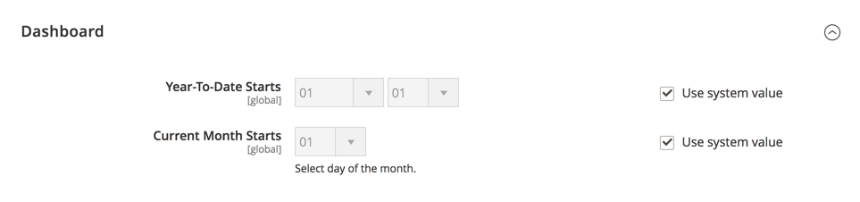

# [!UICONTROL General] > [!UICONTROL Reports]

{{config}}

## [!UICONTROL Dashboard]

<!-- zoom -->

<!-- [Dashboard](https://experienceleague.adobe.com/en/docs/commerce-admin/start/admin/tools/admin-dashboard) -->

| 欄位 | [領域](../../getting-started/websites-stores-views.md#scope-settings) | 說明 |
|--- |--- |--- |
| [!UICONTROL Year-to-Date Starts] | 全域 | 指定年初至今計算所依據的月份與日期。 |
| [!UICONTROL Current Month Starts] | 全域 | 指定用於計算以標示本月初的月份日期。 |

{style="table-layout:auto"}

## [!UICONTROL General Options]

<!-- zoom -->

>[!NOTE]
>
>如果您的業務功能不需要報告，建議您停用報告功能以增強存放區效能。 不過，有些功能（例如動態客戶區段）依賴報表資料才能正常運作。

| 欄位 | [領域](../../getting-started/websites-stores-views.md#scope-settings) | 說明 |
|--- |--- |--- |
| [!UICONTROL Enable Reports] | 全域 | 啟用或停用報表事件。 |
| [!UICONTROL Enable "Product View" Report] | 全域 | 啟用或停用已檢視產品頁面統計資料的收集。 |
| [!UICONTROL Enable "Send Product Link To Friend" Report] | 全域 | 啟用或停用收集傳送給朋友之產品連結的統計資料。 |
| [!UICONTROL Enable "Add Product To Compare List" Report] | 全域 | 啟用或停用收集新增至比較清單之產品的統計資料。 |
| [!UICONTROL Enable "Product Added To Cart" Report] | 全域 | 啟用或停用收集新增至購物車的產品統計資料。 |
| [!UICONTROL Enable "Product Added To Wishlist" Report] | 全域 | 啟用或停用新增至希望清單之產品的統計資料的收集。 |
| [!UICONTROL Enable "Share WishList" Report] | 全域 | 啟用或停用共用希望清單統計資料的收集。 |

{style="table-layout:auto"}
