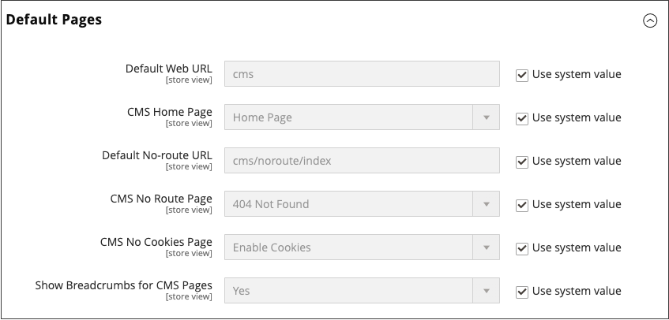

# 設定首頁

您可以維持選取的不同首頁，並啟動您要做為預設首頁的頁面。

1. 完成[新增頁面](page-add.md)的步驟。

1. 在&#x200B;_管理員_&#x200B;側邊欄上，移至&#x200B;**[!UICONTROL Stores]** > _[!UICONTROL Settings]_>**[!UICONTROL Configuration]**。

1. 在左側面板的&#x200B;_[!UICONTROL General]_下，選擇&#x200B;**[!UICONTROL Web]**。

1. 展開 **[!UICONTROL Default Pages]**&#x200B;區段，並將&#x200B;**[!UICONTROL CMS Home Page]**&#x200B;設定為新頁面。

   {width="600" zoomable="yes"}

1. 按一下&#x200B;**[!UICONTROL Save Config]**。

1. 在工作區頂端的訊息中，按一下&#x200B;**[!UICONTROL Cache Management]**&#x200B;連結，並重新整理任何無效的快取。
