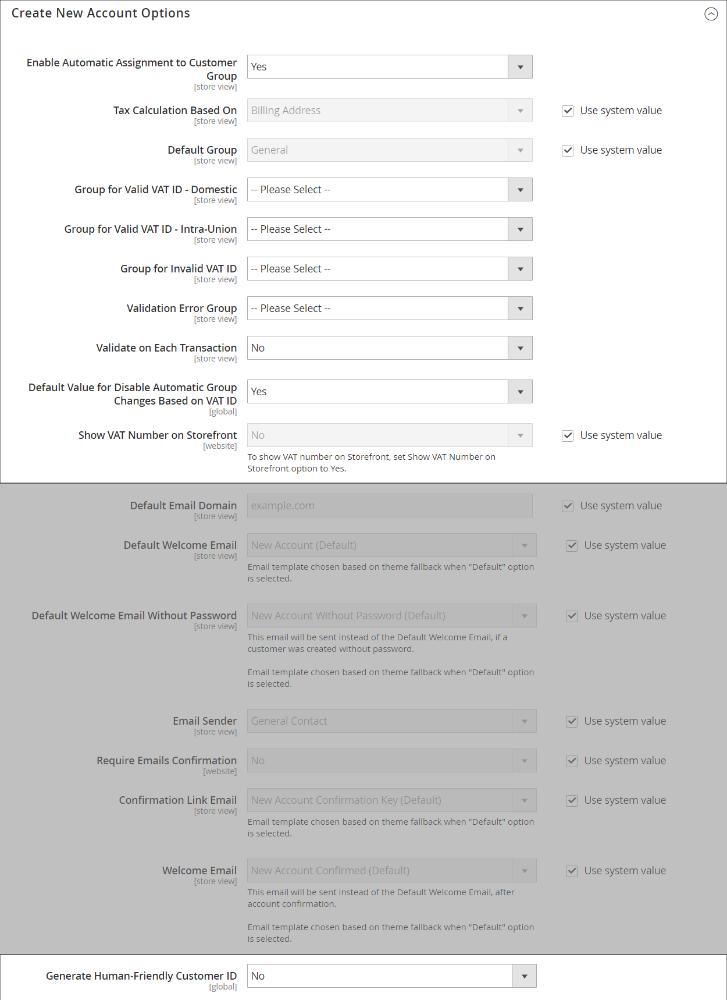

# 新客戶帳戶選項

在設定的&#x200B;_[!UICONTROL Create New Account Options]_&#x200B;區段中，基本帳戶選項與更多與VAT ID驗證和自訂整合相關的進階選項結合。 下列指示僅涵蓋最常使用的選項。 若要瞭解自動客戶群組指派，請參閱[VAT驗證](../stores-purchase/vat.md)。

{width="600" zoomable="yes"}

## 設定基本客戶帳戶選項

1. 在&#x200B;_管理員_&#x200B;側邊欄上，移至&#x200B;**[!UICONTROL Stores]** > _[!UICONTROL Settings]_>**[!UICONTROL Configuration]**。

1. 在左側面板中，展開&#x200B;**[!UICONTROL Customers]**&#x200B;並選擇&#x200B;**[!UICONTROL Customer Configuration]**。

1. 展開&#x200B;**[!UICONTROL Create New Account Options]**&#x200B;區段：

   {width="600" zoomable="yes"}

1. 根據您在店面需要支援的客戶體驗設定每個選項：

   - 將&#x200B;**[!UICONTROL Default Group]**&#x200B;設定為建立帳戶時指派給新客戶的客戶群組。

   - 如果您有&#x200B;_加值稅_&#x200B;編號，並且想要讓客戶看到該編號，請將&#x200B;**[!UICONTROL Show VAT Number on Storefront]**&#x200B;設為`Yes`。

   - 若要在客戶管理員訂單建立期間要求客戶傳送電子郵件，請將&#x200B;**[!UICONTROL Email is required field for Admin order creation]**&#x200B;設為`Yes`。

   - 輸入存放區的&#x200B;**[!UICONTROL Default Email Domain]**，例如`mystore.com`

   - 將&#x200B;**[!UICONTROL Default Welcome Email]**&#x200B;設為傳送給新客戶的歡迎電子郵件所使用的範本。

   - 若要要求客戶確認其透過您的商店開立帳戶的要求，請將&#x200B;**[!UICONTROL Require Emails Confirmation]**&#x200B;設為`Yes`。 然後，將&#x200B;**[!UICONTROL Confirmation Link Email]**&#x200B;設定為用於確認電子郵件的範本。

     >[!NOTE]
     >
     >從2.4.7版開始，無論瀏覽器為何，客戶都必須在電子郵件確認後，重新輸入電子郵件和密碼以登入其帳戶。

   - 將&#x200B;**[!UICONTROL Welcome Email]**&#x200B;設定為用於確認帳戶後所傳送之歡迎訊息的範本。

   - 將&#x200B;**[!UICONTROL Default Welcome Email without Password]**&#x200B;設為建立尚未有密碼的客戶帳戶時使用的範本。 例如，從「管理員」建立的客戶帳戶尚未指派密碼。

   - 將&#x200B;**[!UICONTROL Email Sender]**&#x200B;設定為顯示為歡迎電子郵件寄件者的商店連絡人。

   - 若要要求客戶確認其透過您的商店開立帳戶的要求，請將&#x200B;**[!UICONTROL Require Emails Confirmation]**&#x200B;設為`Yes`。 然後，將&#x200B;**[!UICONTROL Confirmation Link Email]**&#x200B;設定為用於確認電子郵件的範本。

   {width="600" zoomable="yes"}

   如需此組態選項集中每個可用選項的詳細資訊，請參閱&#x200B;_建立新帳戶選項_ [組態參考](../configuration-reference/customers/customer-configuration.md)。

1. 完成時，按一下&#x200B;**[!UICONTROL Save Config]**。
