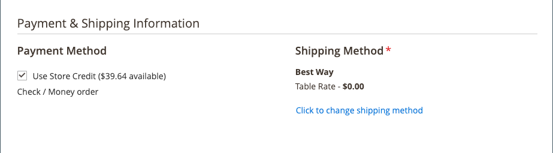

# 套用商店點數

{{ee-feature}}

商店管理員可以檢視客戶帳戶的信用餘額和歷史記錄，也可以將商店信用套用至購買。

{width="600" zoomable="yes"}

## 儲存信用角色資源

僅[!BADGE SaaS]{type=Positive url="https://experienceleague.adobe.com/en/docs/commerce/user-guides/product-solutions" tooltip="僅適用於Adobe Commerce as a Cloud Service專案（Adobe管理的SaaS基礎結構）。"}

下列資源決定哪些管理員使用者可以變更客戶的商店信用餘額，以及哪些使用者可以將商店信用套用至訂單。 如需將資源指派給使用者角色的資訊，請參閱[角色資源](../systems/permissions-user-roles.md#role-resources)。

- **[!UICONTROL Customers]** > **[!UICONTROL All Customers]** > **[!UICONTROL Manage Store Credit Balances]**&#x200B;可讓使用者檢視及更新商店信用餘額。 若沒有它，**[!UICONTROL Customer View]**&#x200B;標籤上的&#x200B;**[!UICONTROL Store Credit]**&#x200B;標籤和&#x200B;**[!UICONTROL Store Credit Balance]**&#x200B;將不可見。 使用者仍然可以對客戶帳戶進行其他編輯。

- **[!UICONTROL Sales]** > **[!UICONTROL Operations]** > **[!UICONTROL Orders]** > **[!UICONTROL Actions]** > **[!UICONTROL Create]** > **[!UICONTROL Can Spend Store Credit]**&#x200B;允許使用者在[建立訂單](../stores-purchase/customer-account-create-order.md)時套用商店點數。 若沒有此核取方塊，**[!UICONTROL Use Store Credit]**&#x200B;核取方塊將不可見。

使用REST API的管理員使用者和整合需要&#x200B;**[!UICONTROL Can Spend Store Credit]**&#x200B;資源，才能將商店點數套用至購物車，或針對已套用商店點數的購物車下訂單。 如需詳細資訊，請參閱[商店點數](https://developer.adobe.com/commerce/webapi/rest/saas-integrations/store-credit/)。

## 檢視貸方餘額

1. 在&#x200B;_管理員_&#x200B;側邊欄上，移至&#x200B;**[!UICONTROL Customers]** > **[!UICONTROL All Customers]**。

1. 在格線中尋找客戶。

1. 在&#x200B;_動作_&#x200B;資料行中，按一下&#x200B;**[!UICONTROL Edit]**。

1. 捲動&#x200B;_[!UICONTROL Customer View]_頁面並在底部檢視&#x200B;**[!UICONTROL Store Credit Balance]**。

{width="600" zoomable="yes"}

## 更新商店貸方餘額

1. 在&#x200B;_管理員_&#x200B;側邊欄上，移至&#x200B;**[!UICONTROL Customers]** > **[!UICONTROL All Customers]**。

1. 在格線中尋找客戶。

1. 在&#x200B;_動作_&#x200B;資料行中，按一下&#x200B;**[!UICONTROL Edit]**。

1. 在左側面板中選擇&#x200B;**[!UICONTROL Store Credit]**。

1. 選擇要與餘額關聯的網站（店面）。

1. 針對&#x200B;**[!UICONTROL Update Balance]**，輸入新值。

1. 若要通知客戶餘額更新，請選取&#x200B;**[!UICONTROL Notify Customer by Email]**&#x200B;核取方塊，然後從&#x200B;**[!UICONTROL Send Email Notification From the Following Store View]**&#x200B;選擇商店檢視。

1. 輸入有關變更的&#x200B;**[!UICONTROL Comment]**。

1. 更新完成時，按一下&#x200B;**[!UICONTROL Save and Continue Edit]**&#x200B;或&#x200B;**[!UICONTROL Save Customer]**。

更新的餘額應顯示在&#x200B;**[!UICONTROL Balance History]**&#x200B;中。

## 以商店管理員的身分，將信用餘額沖銷至訂單

身為商店管理員，您可以代表客戶執行各種作業，包括提交訂單。 當您[建立訂單](../stores-purchase/customer-account-create-order.md)時，您可以套用應付給客戶的商店貸方餘額。 可用的餘額會顯示在&#x200B;_付款與送貨資訊_&#x200B;區段中。 選取&#x200B;**[!UICONTROL Use Store Credit]**&#x200B;核取方塊以套用餘額，或如果訂單總計較少，則套用餘額的一部分。

{width="500" zoomable="yes"}

[!BADGE 僅限SaaS]{type=Positive url="https://experienceleague.adobe.com/en/docs/commerce/user-guides/product-solutions" tooltip="僅適用於Adobe Commerce as a Cloud Service專案（Adobe管理的SaaS基礎結構）。"}只有當您的使用者角色包含&#x200B;**[!UICONTROL Can Spend Store Credit]**&#x200B;資源時，**[!UICONTROL Use Store Credit]**&#x200B;核取方塊才會出現。 請參閱[儲存信用角色資源](#store-credit-role-resources)。

## 結帳時套用商店評價

如果地點有貸方餘額，客戶可以在將訂單放在店面之前，將商店貸方沖銷至訂單餘額。

1. 客戶檢視可用的商店信用金額。

   在&#x200B;_檢閱與付款_&#x200B;步驟期間，可用的金額會顯示在&#x200B;_[!UICONTROL Store Credit]_下方。

1. 若要將金額套用至訂單，請按一下&#x200B;**[!UICONTROL Use Store Credit]**。

   >[!INFO]
   >
   >會重新計算訂單總計，且套用的商店點數金額會顯示在&#x200B;_[!UICONTROL Order Summary]_中。

   {width="700" zoomable="yes"}

1. 準備就緒後，按一下&#x200B;**[!UICONTROL Place Order]**。
