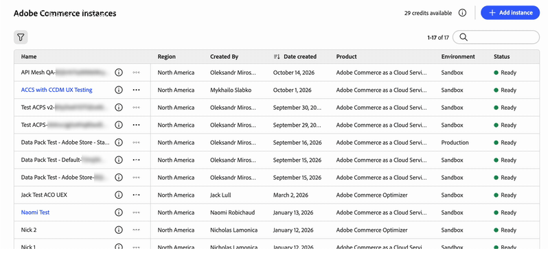
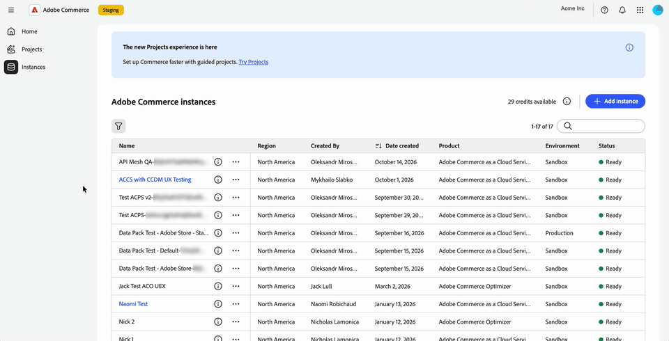

# Adobe Unified Experience中的Commerce管理員

當您在Commerce Manager中選取執行個體名稱時，適用於Adobe Commerce as a Cloud Service的Commerce Cloud Admin會在Adobe Unified Experience中開啟。

Adobe Unified Experience介面提供跨Adobe產品使用的共用頂端導覽、更新的左側導覽和更新的管理員頁面樣式。

您可以在組織、產品和Commerce執行個體之間切換，並從頂部導覽中存取說明、通知和帳戶偏好設定。 您現有的Commerce角色許可權會持續決定您可以存取哪些管理員功能表專案。

>[!NOTE]
>
>Adobe Unified Experience中的Commerce Admin僅適用於Adobe Commerce as a Cloud Service。 雲端基礎結構上的Adobe Commerce和Adobe Commerce內部部署客戶繼續使用[傳統Commerce管理UI](admin.md)。

{width="800" zoomable="yes" border="light"}

## 開啟Commerce Admin

在您登入[Adobe Experience Cloud](https://experience.adobe.com/){target="_blank"}後，請開啟Commerce Cloud Manager。 然後，選取執行個體以在Unified Experience中開啟「管理員」。

登入流程可讓您在Commerce執行個體之間移動，而不需分別登入每個執行個體。
您可以在Adobe產品和Commerce執行個體之間移動，不需要進一步的登入提示。

如需存取程式，請參閱&#x200B;_Adobe Commerce as a Cloud Service指南_&#x200B;中的[存取執行個體](https://experienceleague.adobe.com/zh-hant/docs/commerce/cloud-service/getting-started#access-an-instance){target="_blank"}。
<!--

>[!BEGINTABS]

>[!TAB Open the Admin from Commerce Cloud Manager]

-->
{width="800" zoomable="yes" border="light"}

<!--
>[!TAB See it in action]

{width="800" zoomable="yes" border="light"}

>[!ENDTABS]

-->

### 選擇管理員介面 {#classic-ui}

針對Unified Experience中Commerce Admin的初始版本，Adobe Commerce as a Cloud Service支援兩個Commerce管理體驗，即Adobe Unified Experience和Classic UI。

根據預設，當您在Commerce Cloud Manager中選取Commerce執行個體時，Commerce管理員會在Adobe Unified Experience中開啟。 若要切換回傳統UI，請使用現有書籤或尋找傳統UI的URL。 請參閱[開啟傳統UI](#open-classic-ui)。

Unified Experience和Classic UI的連結可在Commerce Cloud Manager的執行個體詳細資訊面板中取得。

| 連結 | 體驗 |
| --- | --- |
| **[!UICONTROL Admin URL (Unified Shell UI)]** | 在Unified Experience中開啟「管理員」。 |
| **[!UICONTROL Admin URL (Classic UI)]** | 開啟先前的管理介面。 |

{width="800" zoomable="yes" border="light"}

_根據執行個體清單熒幕擷圖和更新的執行個體詳細資料設計圖例。 顯示的URL使用暫存主機。_

#### URL格式

| 體驗 | URL模式 |
| --- | --- |
| Unified Experience | `https://<experience-cloud-host>/#/@<organization>/in:<instance-id>/commerce/cloud-service/admin` |
| 傳統UI | `https://<commerce-admin-host>/<instance-id>/admin/` |

Unified Experience會在`@`之後識別組織，並在`in:`之後識別執行個體。 傳統UI會將執行個體ID直接放置在主機名稱后面。

例如，這些中繼URL會開啟相同的例項：

- **整合式體驗**： `https://experience-stage.adobe.com/#/@adobe-commerce-uex/in:<instance-id>/commerce/cloud-service/admin`
- **傳統UI**： `https://na1-stage.admin.commerce.adobe.com/<instance-id>/admin/`

這些中繼主機名稱不是生產URL。 一律使用來自Commerce Cloud Manager的執行個體連結，而非建構URL。

#### 開啟傳統UI

若要開啟傳統UI：

- 使用現有的傳統管理書籤或URL。 這些URL只會開啟傳統UI，不會重新導向至整合式Experience。
- 在Commerce Cloud Manager執行個體詳細資料中選取&#x200B;**[!UICONTROL Admin URL (Classic UI)]**。

Admin內沒有介面開關。 使用Commerce Cloud Manager或儲存的管理員URL，返回Classic介面（如果需要）。

## 識別您的組織和執行個體

進行變更之前，請先檢查您所使用的組織和執行個體：

- 帳戶功能表會顯示您目前的組織。
- 頂端導覽列中的執行個體切換器會顯示執行個體名稱以及&#x200B;**[!UICONTROL Production]**&#x200B;或&#x200B;**[!UICONTROL Sandbox]**&#x200B;徽章。

在執行個體之間切換時，使用環境徽章來區分生產執行個體和沙箱。

## 切換組織、產品和例項

頂端導覽提供切換工作內容的個別控制項。

### 切換組織

使用頂端導覽列中的組織切換器，在您可以存取的組織之間移動。

1. 在頂端導覽列中選取組織名稱。

1. 從清單中選取組織。

   此清單會顯示您有權存取的組織。 核取記號可識別您正在工作的組織。

>[!BEGINTABS]

>[!TAB 組織切換器]

{width="800" zoomable="yes" border="light"}

>[!TAB 在操作中檢視它]

{width="800" zoomable="yes" border="light"}

>[!ENDTABS]

帳戶功能表也會顯示您正在處理的組織。 在頂端導覽中選取您的個人資料圖片（{width="24"}），然後檢查&#x200B;**[!UICONTROL Organization]**&#x200B;行。

顯示目前組織的{width="800" zoomable="yes" border="light"}

您可以開啟的執行個體屬於您正在工作的組織。 若要變更執行個體，請參閱[切換Commerce執行個體](#switch-commerce-instances)。

### 切換產品

使用頂端導覽列中的產品切換器（{width="24"}），隨時變更應用程式。 其運作方式與其他Adobe產品相同。

- **Admin Console**：從產品切換器開啟Adobe Admin Console以管理使用者及其存取權(**[!UICONTROL Administer]** > **[!UICONTROL Users]**)。 您不需要記住URL。 Adobe Admin Console與Commerce管理員不同，您可在其中管理存放區。
- **Adobe Exchange**：尋找Adobe Creative Cloud、Adobe Experience Cloud和Adobe Document Cloud的協力廠商擴充功能、外掛程式、指令碼和企業整合。
- **其他產品**：開啟產品，例如同事。

>[!BEGINTABS]

>[!TAB 產品切換器功能表]

{width="800" zoomable="yes" border="light"}

>[!TAB 在操作中檢視它]

{width="800" zoomable="yes" border="light"}

>[!ENDTABS]

如需Adobe Commerce as a Cloud Service使用者和角色管理的相關資訊，請參閱[使用者管理](https://experienceleague.adobe.com/zh-hant/docs/commerce/cloud-service/user-management){target="_blank"}。

### 切換Commerce執行個體

頂端導覽列含有執行個體切換器按鈕。 它一律會顯示&#x200B;**[!UICONTROL Production]**&#x200B;或&#x200B;**[!UICONTROL Sandbox]**&#x200B;徽章以及您所在的執行個體名稱。

1. 在頂端導覽區域中，選取顯示您目前執行個體名稱和環境徽章的執行個體切換器。

1. 從清單中選取執行個體。

   此清單包含您可在目前組織中存取的Adobe Commerce as a Cloud Service執行個體。 您不需要返回Commerce Cloud Manager來切換執行個體，因此可以在執行個體之間來回移動。

1. 檢查執行個體名稱和環境徽章，然後再繼續您的工作。

執行個體是頁面URL的一部分，因此您可以將開啟特定執行個體的連結加入書籤或共用。 如果您開啟管理員時連結中沒有執行個體，這會載入您使用的最後一個執行個體。

## 使用左側導覽

Commerce管理功能表會顯示在Adobe Unified Experience的左側導覽器中。 展開或收合功能表區段以尋找所需的工具，或鍵入以跳至功能表專案。

功能表專用於您正在使用的執行個體。 當您切換執行個體時，左側導覽會更新以相符。

您現有的角色許可權會延續下去。 您只會看到您的角色允許的功能表專案。

繼續使用「管理員指南」執行管理產品、訂單、客戶和設定等工作。 管理員頁面已重新整理樣式，因此其外觀可能會與本指南中傳統UI的熒幕擷取畫面不同。

>[!BEGINTABS]

>[!TAB Commerce管理員左側導覽]

{width="800" zoomable="yes" border="light"}

>[!TAB 在操作中檢視它]

{width="800" zoomable="yes" border="light"}

>[!ENDTABS]

## 取得說明並提供意見回饋

若要在不離開Commerce管理員的情況下存取資源，請使用頂端導覽列中的說明圖示（{width="24"}）開啟說明面板。

- **說明**：直接從面板搜尋Adobe Experience League的檔案。
- **支援**：存取社群論壇和其他學習資源，並在Adobe Experience League上尋找您的支援票證。
- **意見反應**：從相同面板將意見反應提交至Adobe。

內容中提供說明、支援和意見回饋。 留在Commerce管理員中不會失去您的位置。

>[!BEGINTABS]

>[!TAB 說明面板]

{width="800" zoomable="yes" border="light"}

>[!TAB 在操作中檢視它]

{width="800" zoomable="yes" border="light"}

>[!ENDTABS]

## 檢視通知 {#view-notifications}

若要檢視內容中的通知、要求和產品公告，請使用頂端導覽列中的鈴鐺圖示（{width="24"}）開啟通知面板。

面板將您的&#x200B;**[!UICONTROL Requests]**、**[!UICONTROL Notifications]**&#x200B;和&#x200B;**[!UICONTROL Announcements]**&#x200B;集中在一起。 您不需要離開Commerce管理員就能檢視其中任何專案。

使用此面板的Unified Experience頂端導覽列中的鈴鐺圖示，而非Commerce頁面標題中的通知控制項。 如需Commerce管理員收件匣訊息的說明，請參閱[訊息收件匣](admin-message-inbox.md)。

>[!BEGINTABS]

>[!TAB 通知面板]

{width="800" zoomable="yes" border="light"}

>[!TAB 在操作中檢視它]

{width="800" zoomable="yes" border="light"}

>[!ENDTABS]

## 管理帳戶偏好設定

在頂端導覽中選取您的個人資料圖片（{width="24"}）以開啟帳戶功能表。 從此功能表，您可以：

- 檢視您正在處理的組織。
- 使用&#x200B;**[!UICONTROL Dark theme]**&#x200B;切換開啟深色模式。
- 開啟您的使用者偏好設定。

>[!BEGINTABS]

>[!TAB 具深色模式的帳戶功能表]

{width="800" zoomable="yes" border="light"}

>[!TAB 在操作中檢視它]

{width="800" zoomable="yes" border="light"}

>[!ENDTABS]

## 已更新頁面樣式

Commerce管理員中的頁面會重新整理外觀，以符合Adobe Unified Experience。 已計畫對較新的版本進行更多重新樣式設定。

>[!MORELIKETHIS]
>
>[Adobe CX Enterprise介面與管理指南](https://experienceleague.adobe.com/zh-hant/docs/core-services/interface/experience-cloud)
