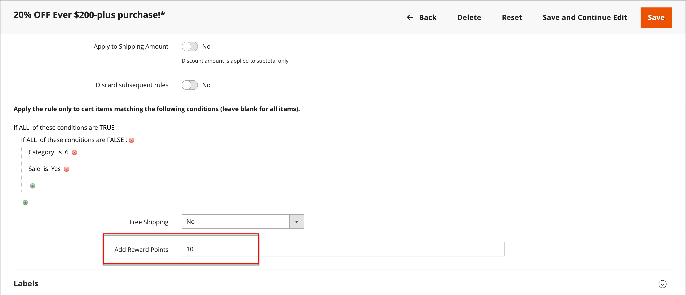

# 價格規則中的獎勵點數

{{ee-feature}}

可根據[購物車價格規則](price-rules-cart.md)將獎勵點數授予客戶。 獎勵積分可能是價格規則的唯一動作，也可以與折扣搭配使用。

>[!NOTE]
>
>[在結帳期間由客戶和管理員使用者兌換獎勵點數時，需要](reward-exchange-rates.md)獎勵匯率設定。

## 將獎勵點數新增至價格規則

1. 在&#x200B;_管理員_&#x200B;側邊欄上，移至&#x200B;**[!UICONTROL Marketing]** > _[!UICONTROL Promotions]_>**[!UICONTROL Cart Price Rules]**。

1. 按一下&#x200B;**[!UICONTROL Add New Rule]**&#x200B;以建立購物車價格規則，或按一下現有購物車價格規則以開啟它。

1. 向下捲動，展開 **[!UICONTROL Actions]**&#x200B;區段，設定條件，並在&#x200B;**[!UICONTROL Add Reward Points]**&#x200B;欄位中輸入點數。

   {width="600" zoomable="yes"}

1. 依照標準指示完成[購物車價格規則](price-rules-cart-create.md)。

   啟用價格規則時，購物車中會顯示訊息，告知客戶可以下訂單得多少分。 這僅適用於已註冊的使用者，且當使用者登入時可能會有所不同。
